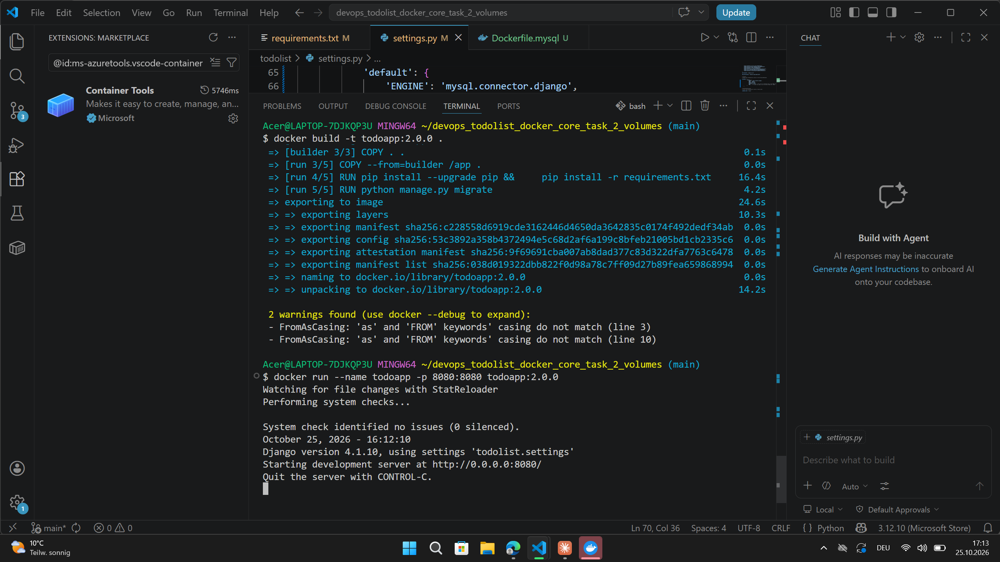

# Instruction

## Docker Hub
- App image: https://hub.docker.com/r/viktor27094872/todoapp (tag `2.0.0`)
- MySQL image: https://hub.docker.com/r/viktor27094872/mysql-local (tag `1.0.0`)

## 1. Run MySQL container with a volume
```
docker build -f Dockerfile.mysql -t mysql-local:1.0.0 .
docker run -d --name mysql-db -p 3306:3306 -v mysql_data:/var/lib/mysql mysql-local:1.0.0
```
Data is stored in the `mysql_data` volume, so it persists after the container is removed.

## 2. Get the MySQL container IP
```
docker inspect -f '{{range .NetworkSettings.Networks}}{{.IPAddress}}{{end}}' mysql-db
```
Put this IP into `HOST` in `todolist/settings.py` (e.g. `172.17.0.2`).

## 3. Build and run the App container
The app `Dockerfile` (repository root) runs Django on port 8080 (`runserver 0.0.0.0:8080`), so the port mapping is `8080:8080`.
MySQL container must be running before the build (migrations run during build).
```
docker build -t todoapp:2.0.0 .
docker run -d --name todoapp -p 8080:8080 todoapp:2.0.0
```

## 4. Access the application
Open in browser: http://localhost:8080

## Screenshot

